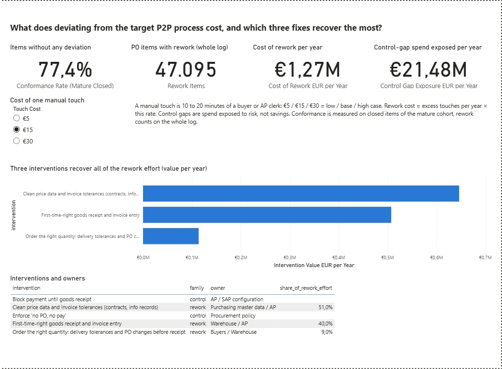
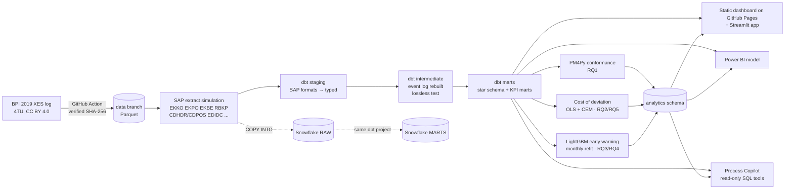
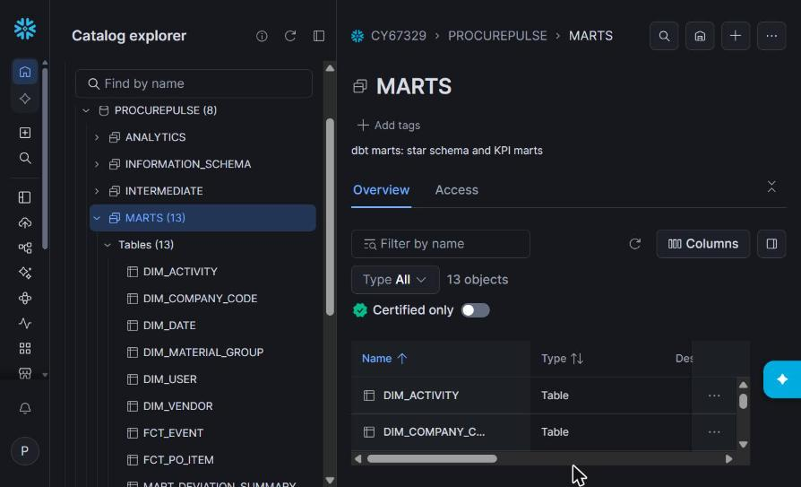

# ProcurePulse: SAP purchase-to-pay process mining

**What does deviating from the target purchase-to-pay process cost a large manufacturer in time, rework
and risk, what drives it, and which three interventions would recover the most of it, early enough to act?**

ProcurePulse answers that question on a **real SAP purchase-to-pay log** (BPI Challenge 2019: 1.6 M events,
251,734 PO items, 1,975 vendors, 4 company codes) with the stack of a modern data team: an SAP table
extract, dbt on DuckDB and Snowflake, process mining with PM4Py, causal-style effect estimation, a
leak-free early-warning model, a static dashboard and a Streamlit app, a Power BI report built as code and an
LLM copilot that can only read.

[](https://github.com/Parsaka/procurepulse/actions/workflows/ci.yml)

**Live dashboard:** [parsaka.github.io/procurepulse](https://parsaka.github.io/procurepulse/), a static page
built from the same exported results (`site/build.py`, deployed by `.github/workflows/pages.yml`).

## The answer

| | |
|---|---|
| Items that follow their target process | **77%** (60% of value); 97.5% fit structurally, rework breaks the rest |
| Rework items per year | **≈ 49,300** (price change after invoice, quantity change after GR, variance payment block, reversal) |
| Cost of rework | **84,500 extra manual touches and 846,000 extra item-days a year ≈ €1.27 M** at €15/touch (€0.42 M to €2.54 M) |
| What drives it | **5% of vendors cause 81% of rework**; the vendor's and buyer's track record carry 69% of the model signal |
| Top 3 interventions | **Clean price data and invoice tolerances (51%)**, **first-time-right GR and invoice entry (40%)**, **order the right quantity (9%)** |
| Control gaps (risk) | **€21.5 M spend a year** bypasses the PO control, €19.5 M of it POs raised after the invoice |
| Early enough? | Scored at PO creation, the top-10% queue has **1.9× the average rework rate** (monthly refit, strict time split) |

Full write-up with confidence intervals and limits: **[docs/findings.md](docs/findings.md)**.

**Power BI report** (generated from code by [`bi/powerbi/build_pbip.py`](bi/powerbi/README.md), five pages):



[Process](docs/img/powerbi_process.png) · [Deviation cost](docs/img/powerbi_deviation_cost.png) ·
[Vendors](docs/img/powerbi_vendors.png) · [Early warning](docs/img/powerbi_early_warning.png)

## Architecture



**Snowflake run** ([workflow](.github/workflows/snowflake.yml), Nov 2026 trial, AWS Frankfurt): 15 SAP tables plus 3 audit
tables loaded into `RAW` with key-pair auth (row counts checked against the Parquet files), the same dbt project built and tested
on Snowflake (76 of 76 nodes pass), and the Python results loaded into `ANALYTICS`. The marts match DuckDB exactly:
1,595,923 events, 251,734 PO items, €996.8 M PO value, 77.43% conformance (mature, closed items), 52 monthly KPI rows.



## Stack and why each piece

| Piece | Choice | Why | Cost |
|---|---|---|---|
| Source data | BPI Challenge 2019 | real SAP P2P log of a multinational, citable | €0 |
| SAP layer | simulated extract with SAP field names | real projects start from SAP tables, not event logs ([ADR 2](docs/adr/0002-simulate-the-sap-extract.md)) | €0 |
| Transformation | dbt Core | the de-facto standard; tests and docs as code | €0 |
| Warehouse | DuckDB (local, CI) + Snowflake (trial) | runs forever for free, and shows the cloud warehouse in job ads ([ADR 1](docs/adr/0001-warehouse-duckdb-and-snowflake.md)) | €0 |
| Infrastructure | Terraform | Snowflake roles, warehouse and resource monitor as code | €0 |
| Process mining | PM4Py | open-source, token replay and BPMN like Celonis concepts | €0 |
| Statistics / ML | statsmodels, LightGBM, SHAP | effect sizes with confidence intervals; explainable risk scores | €0 |
| Demo | GitHub Pages (static) + Streamlit (local) | public, always on, no server ([ADR 6](docs/adr/0006-free-hosting.md)) | €0 |
| BI | Power BI Desktop, report as code (PBIP) | the BI tool most German job ads name; model and pages are generated and reviewable | €0 |
| LLM | Claude API, read-only tools | natural-language questions with auditable SQL ([ADR 5](docs/adr/0005-copilot-read-only.md)); SQL guard and agent loop unit-tested, 30-question eval ready but not run (needs a paid API key) | €0 until a key is added |
| CI | GitHub Actions | rebuilds and checks every number on each push | €0 |

## Run it

```bash
pip install -r requirements.txt         # Python 3.11+, plus graphviz for the process maps
make all                                # data → SAP extract → dbt build → analytics → ML → exports → tests
make app                                # Streamlit on localhost:8501
```

`make help` lists every stage. A full run takes a few minutes on a laptop.

| Target | What it does |
|---|---|
| `make data` | raw log from the repository's `data` branch (published by the `fetch-data` workflow) |
| `make extract` | 15 SAP tables (plus 3 audit tables) in `data/landing/sap`, partitioned by load month |
| `make dbt` | 30 models and 45 data tests on DuckDB (incl. lossless reconstruction) |
| `make analytics` / `make ml` | RQ1, RQ2, RQ5 / RQ3, RQ4 |
| `make app-data` / `make bi` | aggregates for the app / star schema for Power BI |
| `make copilot-eval` | 30-question copilot eval (needs `ANTHROPIC_API_KEY`) |
| `make tf-validate`, `snowflake-load`, `snowflake-dbt` | Snowflake path |

## Repository

```
extract/        SAP extract simulation (event log → EKKO, EKPO, EKBE, RBKP, CDHDR/CDPOS, ...)
dbt/            staging → intermediate (event log) → marts; macros for DuckDB/Snowflake; tests
analytics/      conformance (PM4Py), cost of deviation, exports
ml/             early-warning model
app/            Streamlit app + its aggregated data
site/           static dashboard for GitHub Pages
bi/powerbi/     Power BI project generator (TMDL model + PBIR report), DAX measures, Power Query
copilot/        LLM copilot, read-only SQL guard, API, eval set
infra/snowflake Terraform for database, schemas, warehouse, monitor, roles, service users
loader/         Parquet → Snowflake loader (PUT + COPY INTO, key-pair auth)
docs/           findings, cost model, SAP data model (EN/DE), KPI definitions, ADRs
```

## Documentation

- [Setup guide](docs/setup.md): dashboard hosting, Snowflake, copilot eval, Power BI
- [Findings](docs/findings.md): the answer, RQ by RQ, with limits
- [Cost model](docs/cost_model.md)
- [SAP data model (EN/DE)](docs/sap_data_model.md)
- [KPI definitions](docs/kpi_definitions.md)
- [Architecture decisions](docs/adr/)
- [Power BI build guide](bi/powerbi/README.md)

## Data and licence

BPI Challenge 2019, van Dongen, B.F. (2019), 4TU.ResearchData, https://doi.org/10.4121/uuid:d06aff4b-79f0-45e6-8ec8-e19730c248f1,
licensed CC BY 4.0. The SAP tables in this project are rebuilt from that log; they are not an extract of a
live SAP system. Code: MIT.
